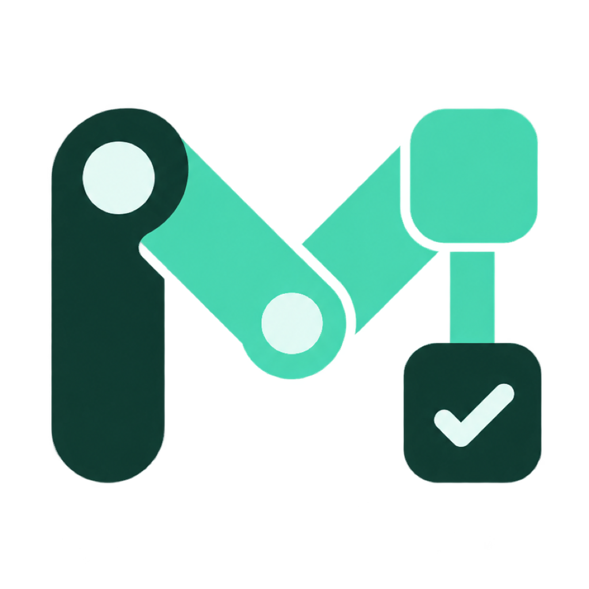

  

<h1 align="center">Vibe Kit</h1>

Give your coding Agent a way of working that stays with the project.

<strong>English</strong> · <a href="README.zh-CN.md">简体中文</a>

Latest published · <a href="https://github.com/mintgao/vibe-kit/releases/tag/v0.12.0"><code>v0.12.0 Pre-release</code></a>

This checkout contains an **unpublished 0.13.0 source candidate** with runnable Python/Node extension-test templates, an optional payload identity check, and guidance for controlled upgrade maintenance and evidence readback. See the [candidate notes](docs/releases/0.13.0.md). Public installation links below select the published v0.12.0 Pre-release.

## Turn a goal into work you can follow

Tell your Agent what you want to build or fix. Vibe Kit supplies project instructions, reusable workflows, and local verification tools so the work has a place to start, a way to be checked, and a record of what remains.

The instructions and project context live in your repository. A new task or collaborator can pick up the same pinned version instead of relying only on the previous conversation.

## What can you do with it?

These are example requests and the workflow or tool support Vibe Kit provides.

| When you want to… | Try asking… | What the Kit supports |
|---|---|---|
| Work on an existing project | “Understand this project, then add email sign-in.” | Repository-backed context, a bounded scope, and review before significant technical choices. |
| Fix a problem | “Find why the home page is slow on first load and fix the confirmed cause.” | An investigation workflow that connects a proposed fix to observations and verification. |
| Understand a long check | “Which check is running, and when did it start?” | Available local progress metadata, including silent checks; optional complete logs to inspect afterward. |
| Upgrade the workflow | “Upgrade this project's Vibe Kit and preserve my project files.” | A plan before writes, conflict protection, recovery paths, and a separate check of installed health. |

Delivery guidance asks the Agent to explain what was completed, what was checked, and what still needs an action or permission. Unverified stages remain unfinished. Complete success logs are opt-in with `all-configured` and stay private.

## Get started

The published version to install is **[v0.12.0 Pre-release](https://github.com/mintgao/vibe-kit/releases/tag/v0.12.0)**. Open your project in Codex and send this, replacing the final goal:

> Adopt Vibe Kit from https://github.com/mintgao/vibe-kit/releases/tag/v0.12.0 into this project. Preserve my existing files and documentation, verify the installation and establish project context, then continue with this goal: [what I want to build or fix].

Starting a new app? Include the app idea, preferred stack, and target folder. For example: “Create an expense-tracking app in `./my-app`, then adopt the exact Vibe Kit version above.”

Already using Vibe Kit? Ask: “Upgrade this project to the exact Release above, show the plan, preserve project-owned files, and check the result.” The target version's trusted payload performs the upgrade. The old CLI does not fetch new versions.

When the supported activation path asks for it, **open a new task in the same project**. Installation health and active rules are separate facts; automatic reload or handoff is conditional on host evidence.

For manual acquisition: [direct Kit ZIP](https://github.com/mintgao/vibe-kit/releases/download/v0.12.0/vibe-kit-0.12.0.zip) · [Codex bootstrap Plugin ZIP](https://github.com/mintgao/vibe-kit/releases/download/v0.12.0/vibe-kit-plugin-0.12.0.zip). The Agent checks published hashes before using downloaded bytes. See the [installation and maintenance guide](docs/maintainers-guide.md) for all assets and technical steps.

## Recent improvements in 0.12.0

- **Inspect an earlier check without running it again.** `inspect-run` separates historical receipts, logs and coverage from present readiness.
- **Check the entry that actually runs.** Applicable shared-helper work connects focused Python discovery or Node package scripts to observed helper origins and arguments.
- **Keep onboarding state precise.** Unknown, boolean and fractional schema versions are rejected without rewriting project state.

Inspection is read-only and bounded. Its evidence cannot attest project origin, current-candidate applicability or liveness. Independent QA and genuine host activation remain separate requirements.

[All 0.12.0 changes](docs/releases/0.12.0.md) · [Published Pre-release](https://github.com/mintgao/vibe-kit/releases/tag/v0.12.0)

## Is it a fit for your project?

- **For repository-based development.** You can adopt it in an existing project or after generating a new app. The CLI needs Python 3.9+ and uses only the standard library; local installation and maintenance can run offline.
- **For supported Agent hosts.** Codex and Hermes have adapter records marked verified. Actual tool access, permissions, and activation still depend on the host. Other hosts need their own adapter and evidence.
- **For checks you configure.** The Kit reports observed outcomes and missing or blocked steps; it does not supply every project's tests or guarantee that an Agent always follows the instructions.
- **For explicit control over sharing.** There is no telemetry or silent public feedback submission. Logs remain private; known-pattern sanitization cannot detect every secret.

This is a Pre-release, with no stable Release or publisher signing. Read the [capabilities and limits](docs/maintainers-guide.md), [verification and log settings](docs/verification-observability.md), or [Agent installation contract](AGENT_INSTALL.md). Earlier release: [v0.11.0](https://github.com/mintgao/vibe-kit/releases/tag/v0.11.0).

## Maintainer checks

The CLI `validate-readiness` validates bounded work-item readiness evidence read-only. `inspect-managed-agents` uses the `unicode-whitespace-v1` word policy when requested; a 2858-word file fails a 2800-word ceiling. These checks preserve project policy. Documentation string tests cannot replace this kind of behavioral evidence; live Agent scenarios remain separate verification. See the [maintainers guide](https://github.com/mintgao/vibe-kit/blob/v0.12.0/docs/maintainers-guide.md) for commands and the earlier v0.10.1 contract history.
